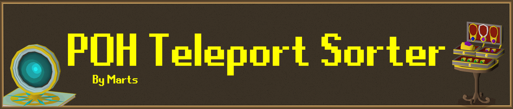
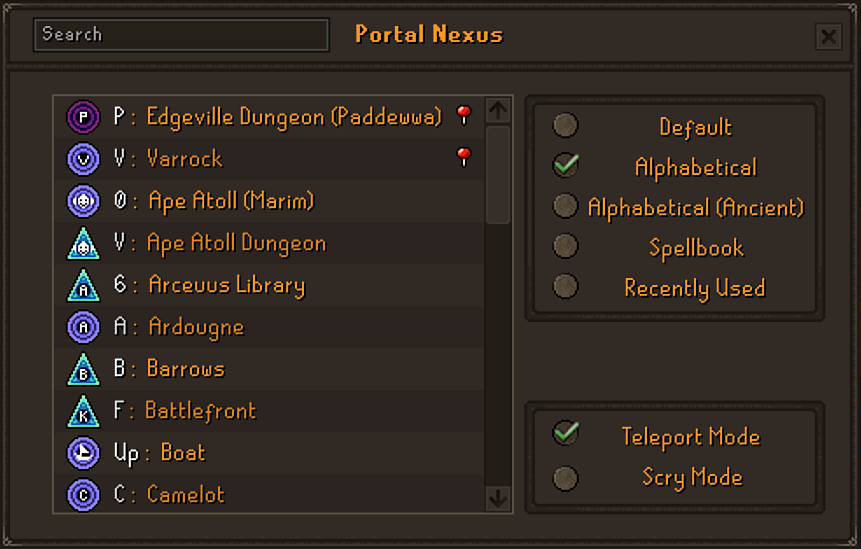
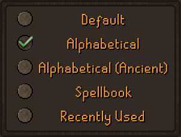
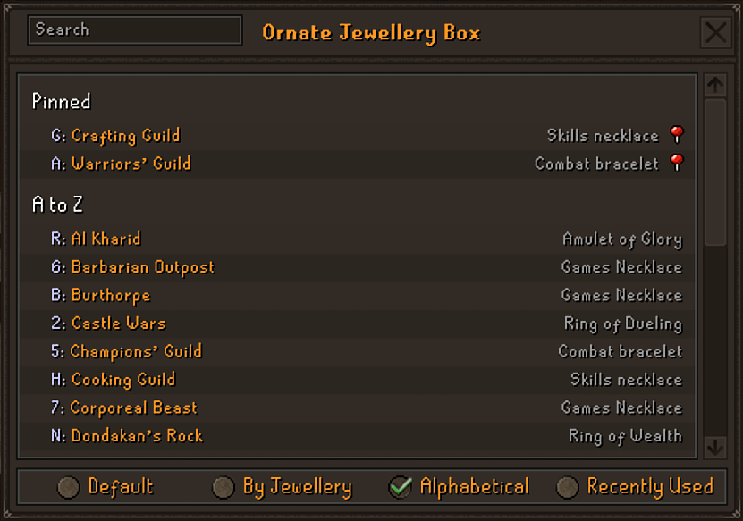
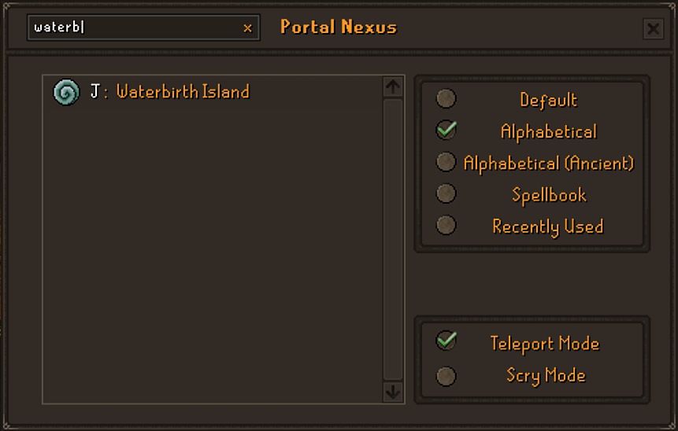
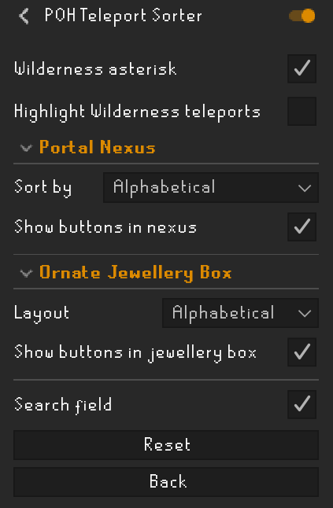

# POH Teleport Sorter

Sort, pin, search and set your own hotkeys for the teleports in your player-owned house: the **Portal Nexus** and the **Ornate Jewellery Box**.

I made this plugin because I was getting frustrated with the game's default layout of the teleport options and found them hard to use. Both menus list their teleports in a fixed order, the nexus as one long list and the jewellery box as a grid split by jewellery, which makes the one you want slow to find. This plugin lets you lay them out the way you like, with the controls built into the game's own windows in the game's own style.

Every teleport still works exactly as it does in the game: one click or one key press is one teleport.

## Features

### Portal Nexus

A box of sort buttons sits inside the Portal Nexus window, above the Teleport Mode / Scry Mode box. Choose how the teleport list is ordered:

- **Default**: the game's own order
- **Alphabetical**: A to Z by destination
- **Alphabetical (Ancient)**: A to Z, with the Ancient Magicks teleports shown and sorted by spell name, e.g. "Kharyll (Canifis)"
- **Spellbook**: grouped Standard, Ancient, Lunar and Arceuus, in each spellbook's in-game order
- **Recently Used**: the teleports you've used most recently first

Clicking, hotkeys and scrying all work as normal; only the order of the rows changes.

### Ornate Jewellery Box

A strip of layout buttons runs along the bottom of the jewellery box:

- **Default**: the game's grid of six jewellery sections
- **By Jewellery**: one scrollable list, each jewellery with its icon and name above its teleports
- **Alphabetical**: every teleport in one A to Z list, with the jewellery it's on shown on the right
- **Recently Used**: the teleports you've used most recently first, then the rest A to Z

Hotkeys, locked (struck-through) teleports and the "Please wait..." message all behave exactly as they do in the game.

### Search

Both windows have a search field in the title bar. Click it and type to filter, e.g. "guild" or "canifis".

- While you're typing, every key goes into the search, so the window's teleport hotkeys can't fire by accident.
- **Enter** finishes typing and keeps the results, so your next key press is a normal hotkey again. Each result still shows its hotkey.
- **Esc** clears the search.
- **Ctrl+A** selects the whole search, so you can type over it or clear it with Backspace or Delete.

Ancient teleports can be found by where they land as well as by spell name, so "canifis" finds Kharyll.

The search field isn't shown while Better Teleport Menu is on; see [Compatibility with Better Teleport Menu](#compatibility-with-better-teleport-menu).

### Pinning

Right-click any teleport in the Portal Nexus or a jewellery box list and choose **Pin**. Pinned teleports get a pin icon and sit at the top in every Portal Nexus sort order and every jewellery box list layout (the jewellery box's Default grid stays exactly as the game draws it). Right-click and choose **Unpin** to remove one. The left-click option is always the game's own teleport.

### Custom hotkeys

Right-click any teleport in the Portal Nexus or the jewellery box (in any layout) and choose **Set hotkey**. The row shows "Press a key": press the key you want, on its own or with Shift, Ctrl or Alt. Esc cancels. The row then shows your key in place of the game's.

- A teleport with your own key no longer answers to the game's old key for it, so the key shown next to each teleport is always the one that works.
- If your key was another teleport's game key, that teleport loses it; if it was another teleport's custom key, it moves to the new one.
- Right-click and choose **Reset hotkey** to give a teleport the game's key back.
- Teleports past the game's first 35 have no key in the game; you can give them one.

Your hotkeys work in every sort order and layout, and are saved between sessions. Until you set one, the game's own hotkeys are left completely alone.

Custom hotkeys are off while Better Teleport Menu is on; see [Compatibility with Better Teleport Menu](#compatibility-with-better-teleport-menu).

### Recently used

Every teleport you use is remembered, whether you click it, use its hotkey or pick it from a list (scrying a house in the nexus doesn't count). Your recent teleports, pins and chosen sort order and layout are saved between sessions.

### Wilderness teleports

Two optional settings make teleports that land in the Wilderness easy to spot: Ferox Enclave, Annakarl, Ghorrock, Carrallanger, Dareeyak, Cemetery and Ice Plateau.

- **Wilderness asterisk**: adds a red * after the name
- **Highlight Wilderness teleports**: shows the name in red

## Compatibility with Better Teleport Menu

[Better Teleport Menu](https://github.com/abextm/better-teleport-menu) is another plugin that sets hotkeys for these windows (and many other teleport menus). Whenever it's on, it handles every key press in the Portal Nexus and jewellery box itself, and RuneLite doesn't let one plugin make sure it sees key presses before another. So that the two never fight over the same key, this plugin's search field and custom hotkeys switch off while Better Teleport Menu is on. This plugin only checks whether Better Teleport Menu is on; it never changes anything about it.

| | Better Teleport Menu off | Better Teleport Menu on |
| --- | --- | --- |
| Sort orders and layouts | Yes | Yes |
| Pinning | Yes | Yes |
| Recently used | Yes | Yes |
| Wilderness markers | Yes | Yes |
| Search field | Yes | Hidden |
| Custom hotkeys (Set hotkey) | Yes | Off: use Better Teleport Menu's hotkeys instead |
| Keys shown next to each teleport | The game's, or your own where you've set one | Better Teleport Menu's |

Which to use:

- **Only want hotkeys for the Portal Nexus and jewellery box?** Turn Better Teleport Menu off. This plugin then gives you the search and its own custom hotkeys.
- **Use Better Teleport Menu for other menus too** (spirit trees, the Construction cape, achievement diary items and so on)? Keep it on. You get every feature of this plugin apart from the search and custom hotkeys, and Better Teleport Menu's hotkeys keep working in both windows.

Custom hotkeys you've set are kept while Better Teleport Menu is on and come back when it's turned off. A change takes effect the next time you open the window.

## Configuration

Everything can also be controlled from the plugin's settings in the RuneLite sidebar, and changes apply straight away, even with a window open.

| Setting | Default | What it does |
| --- | --- | --- |
| Wilderness asterisk | Off | Adds a red * after teleports that land in the Wilderness |
| Highlight Wilderness teleports | Off | Shows the names of Wilderness teleports in red |
| Search field | On | Shows the search field in both windows' title bars. Not shown while Better Teleport Menu is on |

**Portal Nexus**

| Setting | Default | What it does |
| --- | --- | --- |
| Sort by | Default | How the nexus teleport list is ordered |
| Show buttons in nexus | On | Shows the sort buttons inside the nexus. Turn off for the game's own window layout and choose the order with Sort by instead |

**Ornate Jewellery Box**

| Setting | Default | What it does |
| --- | --- | --- |
| Layout | Default | How the jewellery box shows its teleports |
| Show buttons in jewellery box | On | Shows the layout buttons along the bottom of the box. Turn off for a cleaner box and choose the layout with Layout instead |

## Issues and support

Found a bug or have an idea? Please [open an issue](../../issues/new) on GitHub. To help me fix a bug quickly, include:

- what you did, what you expected and what happened instead
- which window (Portal Nexus or jewellery box) and which sort order or layout
- a screenshot if you can

You can also see [existing issues](../../issues) to check whether it's already been reported.

## License

[BSD 2-Clause](LICENSE). The banner's lettering uses the [RuneScape UF](https://www.dafont.com/runescape-uf.font) font by Nathan P (nayfan), licensed [CC BY-ND 3.0](https://creativecommons.org/licenses/by-nd/3.0/).
